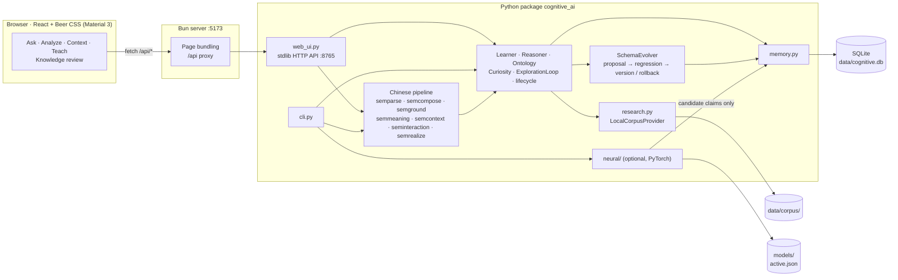
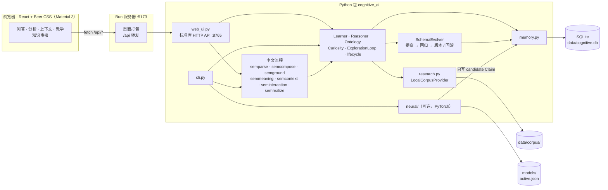

<a id="readme-en"></a>

<div align="center">

# Cognitive AI

**A symbolic concept knowledge base with evidence-gated learning, plus an optional from-scratch character-level classifier.**

<a href="#readme-en"></a>
<a href="#readme-zh"></a>


-PyTorch%202-EE4C2C)


[](LICENSE)

</div>

## Contributors

| Member | GitHub | Role |
| :---: | :---: | :---: |
| samgu-5657 | [`samgu-5657`](https://github.com/samgu-5657) | Project author |
| Bill Zhao | [`Bill092738`](https://github.com/Bill092738) | Web frontend (Material 3) |

---

Cognitive AI is a symbolic concept knowledge base built on the Python standard library and SQLite. It stores concepts, attributes, relations, rules and evidence, answers a limited set of Chinese statements and questions deterministically, and only writes new knowledge after independent sources agree. An optional character-level text classifier, trained from random initialization, connects to the knowledge base only through `candidate` claims.

**No pretrained models and no online LLM are used anywhere.**

> **About the name:** "Cognitive AI" suggests a system that can perceive, understand, reason or learn on its own. This project does not have those general abilities; the name describes a direction of exploration, not a promise of features.

- **Concept knowledge base** with multiple inheritance, cycle detection, a rule engine that returns `unknown` instead of guessing, and versioned schema changes that can be rolled back.
- **Evidence-gated learning**: at least two independent sources must agree before anything is written, and automatic flows never go beyond `hypothesis`.
- **Deterministic Chinese pipeline** for a small, fixed set of sentence patterns: parsing, read-only grounding, clarification and answer realization.
- **Optional neural classifier** (char-level CNN / BiGRU) with group-isolated splits, OOD detection, a review queue and a promotion gate.
- **Conversational Web UI** built with Bun, React and Beer CSS (Material Design 3).

Current feature status, measured results and the clean-up history are in [PROGRESS.md](PROGRESS.md).

---

## Contents

- [Overview](#overview)
- [Features](#features)
- [Architecture](#architecture)
- [Tech stack](#tech-stack)
- [Getting started](#getting-started)
- [Configuration](#configuration)
- [Usage](#usage)
- [Web API reference](#web-api-reference)
- [Project structure](#project-structure)
- [Development and testing](#development-and-testing)
- [Limitations](#limitations)
- [Known issues and plans](#known-issues-and-plans)
- [Documentation](#documentation)
- [License](#license)

---

## Overview

The project has two independent parts:

1. **Concept knowledge base**: stores concepts, attributes, relations, rules and evidence, and provides limited inheritance, querying, learning and version management.
2. **Optional neural classifier**: character-level classification of short handwritten Chinese words and phrases. It is not an image model and not a Chinese understanding model. It talks to the knowledge base only through `candidate` claims, and the core knowledge base does not depend on PyTorch.

Updates to the system are always one of three distinct kinds:

| Kind | What happens |
| --- | --- |
| **Episodic record** | One observation row is inserted into the `experiences` table. |
| **Knowledge structure change** | A concept, attribute, relation or rule changes; a version number is created and the change can be rolled back. |
| **Neural parameter update** | Happens only when a `neural-*` training command is run manually, starting from random initialization. |

---

## Features

### Concept knowledge base

The core lives in `src/cognitive_ai/` and needs no third-party dependencies at runtime.

- Concepts support multiple inheritance with cycle detection. Attributes are inherited along the ancestor chain, and the nearest definition wins.
- The rule engine supports `is_a`, `has_attr` and `relation` conditions with exceptions. When data is missing it returns `unknown` rather than a guess. Rules may bind variables (`?x`) for bounded multi-step chaining with proof chains.
- Schema changes save a snapshot, run a regression check and then create a new version, which can be rolled back. High-impact changes go through `SchemaEvolver`.
- Attributes have a lifecycle: `candidate → hypothesis → supported → verified`, plus `contested`, `rejected` and `superseded`. Automatic flows write at most `hypothesis`; higher states require an explicit `promote`.
- Observations are classified by attribute overlap as `match`, `ambiguous`, `novel` or `insufficient`.
- The exploration loop generates questions from missing attributes, missing relations, isolated concepts and conflicts, within a step and time budget.
- The local research flow does keyword matching over `data/corpus/` and extracts `key: value` or `key是value` with regular expressions. At least two independent sources must give the same short value before it is written as `hypothesis`; with a single source only a `candidate` claim is kept.

These are structured data processing and limited rule inference, not open-domain knowledge acquisition, natural language understanding or general reasoning.

### Deterministic Chinese pipeline

- Compositional parsing of a fixed inventory of patterns (subject / predicate / object / negation / ability modality), including `并且` / `而且` / `同时` conjunctions and `如果 A，那么 B` conditionals.
- Read-only grounding against the knowledge base with verdicts `supported`, `conflicted`, `unknown` and `ambiguous`, each with evidence.
- Explicit-context reference resolution (`它`) and a clarification loop; ambiguity is kept and asked about, never guessed.
- Answer realization that states `hypothesis`, `contested`, inherited, `unknown` and limited results differently, then re-parses the generated answer to check it.
- Chinese statements become pending candidates that must be confirmed or rejected through the existing lifecycle gate.

### Character-level neural classifier

Lives in `src/cognitive_ai/neural/` and requires the optional PyTorch dependency.

- CNN: character embedding, 1-D convolutions with kernel widths 2/3/4, max-pooling and two output heads (5 level-1 classes plus level-2 classes). A bidirectional GRU is included for comparison.
- Training data is handwritten short Chinese words and phrases, split into train/val/test by semantic group, with a leakage check before training.
- Models start from random initialization; no pretrained weights are used.
- Unknown samples can go into a quarantine queue for human review. Incremental training with replay, a regression gate, an active-model pointer, rollback, OOD detection and candidate category discovery are supported.
- Network output only enters the knowledge base as `candidate` claims; it never changes attributes or knowledge base versions directly.

With the current data size, the CNN's level-1 test accuracy is below the handwritten keyword baseline, so this part is suited to experiments and pipeline validation, not to claims of reliable Chinese classification. Reproducible numbers are in [PROGRESS.md](PROGRESS.md).

### Web frontend

- Conversational UI with four modes: **Ask**, **Analyze**, **Context** and **Teach**, plus a **Knowledge review** page for pending candidates.
- Conversation history in the sidebar (rename, delete with undo, search), stored only in the browser's `localStorage`.
- Light / dark / system themes and Material 3 dynamic color generated from a seed color.
- Responsive layout: a collapsible rail on desktop, a slide-out drawer on phones.
- The frontend does no classification, reasoning or learning itself. Only **Confirm / Reject** writes to the knowledge base.

---

## Architecture



| Layer | Responsibility |
| --- | --- |
| **Frontend** (`frontend/`) | Conversational UI. Bun serves the page and forwards `/api/*` to the backend. History and context stay in the browser. |
| **Web API** (`web_ui.py`) | Local HTTP API on the standard library. Every route calls the real modules; handlers do not re-implement parsing, grounding or gating. |
| **CLI** (`cli.py`) | Argument parsing and calls only, no business logic. |
| **Chinese pipeline** (`sem*.py`) | Deterministic parsing, read-only grounding, context, clarification and answer realization. |
| **Core** (`learner.py`, `reasoner.py`, `ontology.py`, …) | Learning, inference, inheritance, curiosity, exploration and the knowledge lifecycle. |
| **SchemaEvolver** | The only module allowed to change the concept structure. |
| **Memory** (`memory.py`) | The only place that reads and writes SQLite; migrations only add tables or columns. |
| **Neural** (`neural/`) | Optional, lazily imports torch; outputs become `candidate` claims only. |

---

## Tech stack

| Area | Technology |
| --- | --- |
| Knowledge base | Python ≥ 3.12 standard library, SQLite |
| Chinese pipeline | Pure-Python deterministic parsing and realization, no models |
| Neural classifier (optional) | PyTorch ≥ 2, char-level CNN / BiGRU, random initialization |
| Web API | Standard-library HTTP server (`web_ui.py`) |
| Frontend | Bun, React 19 (plain JavaScript), [Beer CSS](https://www.beercss.com/) 5 (Material Design 3), `material-dynamic-colors` |
| Testing | pytest · `bun test` |

---

## Getting started

### Prerequisites

| Requirement | Version | Notes |
| --- | --- | --- |
| Python | 3.12+ | On Windows, replace `python` with `py`. |
| PyTorch | 2+ | Optional, only for the neural classifier. |
| [Bun](https://bun.sh) | — | Only for the Web frontend. |

### 1. Install

```bash
pip install -e ".[test]"          # core + pytest
pip install -e ".[neural]"        # optional: PyTorch for the neural classifier
pytest -q
```

The default database is `data/cognitive.db`, initialized from `data/concepts.json` on first run.

### 2. Start the Web UI

```bash
./run.sh              # backend (127.0.0.1:8765) + frontend (127.0.0.1:5173); Ctrl+C stops both
MODE=prod ./run.sh    # production mode, no hot reload
```

On Windows use `run.cmd` (CMD) or `.\run.ps1` (PowerShell), with the same environment variables; production mode is `run.cmd -Mode prod`. The scripts load `src/` through `PYTHONPATH`, so `pip install` is not required, and they run `bun install` on first use.

Open http://127.0.0.1:5173.

### Running the services separately

```bash
python -m cognitive_ai.cli ui                 # backend, 127.0.0.1:8765
cd frontend && bun install && bun run dev     # frontend, 127.0.0.1:5173
```

---

## Configuration

| Variable | Default | Purpose |
| --- | --- | --- |
| `COGNITIVE_AI_DATA` | `data/` | Data directory; must contain `concepts.json` and `corpus/` |
| `COGNITIVE_AI_MODELS` | `models/` | Neural weights and the active-model pointer |
| `BACKEND_HOST` / `BACKEND_PORT` | `127.0.0.1` / `8765` | Backend address (run scripts) |
| `FRONTEND_HOST` / `FRONTEND_PORT` | `127.0.0.1` / `5173` | Frontend address (run scripts) |
| `PYTHON` | `python3` (`run.ps1`: auto-detect) | Python interpreter used by the run scripts |
| `MODE` | `dev` | `dev` (hot reload) or `prod` |
| `COGNITIVE_AI_API` | `http://127.0.0.1:8765` | Backend address the Bun server forwards `/api/*` to |

Set `COGNITIVE_AI_DATA` and `COGNITIVE_AI_MODELS` to run in an isolated environment.

---

## Usage

### Knowledge base commands

```bash
python -m cognitive_ai.cli doctor                 # health check (cycle detection + regression gate)
python -m cognitive_ai.cli concepts               # list concepts
python -m cognitive_ai.cli inspect cup            # concept details, including inherited attributes
python -m cognitive_ai.cli query --json '{"type":"get_attribute","concept":"cup","key":"function"}'
python -m cognitive_ai.cli observe --json-file obs.json   # structured observation → learning
python -m cognitive_ai.cli parse 杯子是容器        # regex parsing of the three basic patterns
python -m cognitive_ai.cli gaps                   # knowledge gaps
python -m cognitive_ai.cli questions              # generate and score research questions
python -m cognitive_ai.cli explore --steps 5      # budgeted autonomous exploration
python -m cognitive_ai.cli consolidate            # try splitting a category on stable attribute differences (regression-gated)
python -m cognitive_ai.cli history                # versions and schema changes
python -m cognitive_ai.cli rollback 1             # roll back to a version
python -m cognitive_ai.cli lifecycle --describe   # lifecycle rules
python -m cognitive_ai.cli promote <attr_id> supported --evidence '[...]'
python -m cognitive_ai.cli experiences --limit 20
```

Input format for `observe`:

```json
{"name": "teapot", "parents": ["vessel"],
 "attributes": {"material": "clay", "function": "brewing"}}
```

### Chinese statements and questions

```bash
python -m cognitive_ai.cli ask 杯子是容器吗 [--json] [--trace]   # read-only question answering
python -m cognitive_ai.cli understand 杯子有把手                # parse + ground, no writes
python -m cognitive_ai.cli semantic-analyze "如果杯子是容器，那么杯子可以装水"
python -m cognitive_ai.cli semantic-context 它可以装水 --prior 杯子是容器
python -m cognitive_ai.cli learn 杯子有把手                     # create a pending candidate
python -m cognitive_ai.cli pending                              # list candidates
python -m cognitive_ai.cli confirm <id>                         # or: reject <id>
python -m cognitive_ai.cli import-data preview statements.txt   # batch import: preview, then stage
```

### Neural classifier commands

These require PyTorch:

```bash
python -m cognitive_ai.cli neural-train --model cnn --tag cnn-v1 --seed 7 --epochs 300
python -m cognitive_ai.cli neural-eval --tag cnn-v1
python -m cognitive_ai.cli neural-compare --tags cnn-v1,gru-v1
python -m cognitive_ai.cli neural-predict 杯子 --tag cnn-v1 [--submit]
python -m cognitive_ai.cli neural-ood-build --tag cnn-v1     # prototypes + thresholds (train/val only)
python -m cognitive_ai.cli neural-ood 跑步机 --tag cnn-v1
python -m cognitive_ai.cli neural-cycle 激光打印机            # predict; low confidence goes to the quarantine queue
python -m cognitive_ai.cli neural-queue --status pending
python -m cognitive_ai.cli neural-review <id> --l1 entity --l2 electronics --accept
python -m cognitive_ai.cli neural-incremental --base cnn-v1 --out cnn-cand1
python -m cognitive_ai.cli neural-queue-export --out reviewed.jsonl
python -m cognitive_ai.cli neural-gate --base cnn-v1 --candidate cnn-cand1 --new reviewed.jsonl --promote
python -m cognitive_ai.cli neural-active
python -m cognitive_ai.cli neural-rollback
python -m cognitive_ai.cli neural-discover --tag cnn-v1
```

Weights are saved in `models/` and never committed. OOD thresholds are set from the train and val sets only; the test set is used only for reporting.

---

## Web API reference

Served by `python -m cognitive_ai.cli ui`. All bodies are JSON.

| Method | Path | Description |
| --- | --- | --- |
| `GET` | `/api/health` | Health check |
| `GET` | `/api/status` | Concept count, rule count and current version |
| `GET` | `/api/pending` | List knowledge candidates (the status filter is currently ignored) |
| `POST` | `/api/ask` | Answer a question, with verdict and evidence |
| `POST` | `/api/analyze` | Compositional semantic analysis tree |
| `POST` | `/api/context` | Reference resolution against explicit prior statements |
| `POST` | `/api/interact` | Check whether a clarification is needed |
| `POST` | `/api/answer` | Answer a clarification request |
| `POST` | `/api/propose` | Propose a knowledge candidate |
| `POST` | `/api/confirm` | Confirm a candidate (writes to the knowledge base) |
| `POST` | `/api/reject` | Reject a candidate |

`/api/confirm` and `/api/reject` call the same `Learner.confirm_candidate` / `reject_candidate` methods as `cli confirm` / `cli reject`.

---

## Project structure

```text
Cognitive-AI/
├── run.sh / run.cmd / run.ps1     # Start backend + frontend together
├── pyproject.toml
├── AGENTS.md                      # Development constraints
├── PROGRESS.md                    # Feature status and measured results
├── data/
│   ├── concepts.json              # Seed concepts
│   ├── corpus/                    # Local research corpus
│   └── neural/                    # Handwritten train/val/test JSONL
├── src/cognitive_ai/              # Python package (see table below)
│   └── neural/                    # Optional neural classifier
├── tests/                         # pytest suites
└── frontend/                      # Bun + React Web frontend (not part of the Python package)
    ├── server.js                  # Page bundling + /api proxy
    ├── src/                       # App.jsx, components/, lib/
    └── tests/                     # bun test
```

| Module | Purpose |
| --- | --- |
| `models.py` | Data classes, no IO |
| `memory.py` | The only SQLite access layer, with incremental migrations |
| `ontology.py` | Concept CRUD, multiple inheritance, cycle detection, attribute inheritance |
| `reasoner.py` | `is_a` / attribute / relation queries, forward rules, variable-bound chaining, conflict checks |
| `matching.py` | Shared, pure unification kernel |
| `novelty.py` | Observation novelty, knowledge gaps, three-pattern regex parsing |
| `schema_evolver.py` | The only module that changes the concept structure: proposal → regression → version / rollback |
| `curiosity.py` | Generates questions from gaps and scores them with a weighted formula |
| `research.py` | `LocalCorpusProvider` (keywords + content hash + relevance grading) |
| `lifecycle.py` | Knowledge state machine and promotion conditions |
| `learner.py` | Observation → research → write; `classify`; `consolidate`; candidate confirm / reject |
| `loop.py` | Exploration loop with step / time budget |
| `policy.py` | All thresholds in one place |
| `knowledge_import.py` | Batch import: read-only preview, then explicit staging |
| `semparse.py`, `semcompose.py` | Compositional Chinese statement and question parsing |
| `semground.py`, `semmeaning.py` | Read-only grounding and compositional grounding |
| `semcontext.py`, `seminteraction.py` | Explicit context, reference resolution, clarification loop |
| `semrealize.py` | Deterministic Chinese answer realization |
| `world_*.py` | World-model library modules: read-only adapter, symbolic action simulation, state-scoped reasoning, prediction, review, learning gate, persistence and controlled change application (not exposed via the CLI or Web UI) |
| `cli.py` | Command-line entry point, no business logic |
| `web_ui.py` | Local HTTP API (standard library) for the Web frontend |
| `neural/` | Vocabulary, dataset, models, training, evaluation, adapter, queue, gate, OOD, category discovery |

---

## Development and testing

```bash
# Python
pytest -q                     # full suite; torch-dependent tests are skipped without torch
pytest -s tests/test_eval_concept_learning.py   # print evaluation output

# Frontend
cd frontend
bun test                      # API client, conversation state and response helpers
bun run build                 # static bundle into dist/
```

Tests do not depend on local machine paths or files. See [AGENTS.md](AGENTS.md) for the development rules every change must follow, and [frontend/README.md](frontend/README.md) for frontend details.

---

## Limitations

- Free text supports only a small fixed set of sentence patterns; other input needs structured JSON.
- The system does not understand Chinese semantics. The character-level classifier learns character patterns in a limited dataset; it is not a language model.
- There is no semantic retrieval. "Research" is keyword matching and regex extraction over about 1 KB of local text; source independence checks mainly catch verbatim copies and light rewrites.
- It is not a continual learning system. Knowledge base updates are database inserts and state changes; the network only updates when a training command is run manually.
- `WebSearchProvider` is only an interface and raises `NotImplementedError`; there is no network access and no online source review scheme.
- Evaluation sets and comparison experiments have 3–12 samples each. Results only show that the code paths run, not that learning brings a stable gain.

---

## Known issues and plans

### Known issues

These do not affect basic operation but limit generalization:

- `learner.default_regression` only checks "no cycles" and "`cup` is still a descendant of `container`", so it is tied to the seed data rather than being a general regression test.
- `curiosity.IMPORTANT_CONCEPTS` hard-codes four seed concept IDs to boost relevance.
- `classify` uses a handwritten scoring formula; the `0.3` threshold has not been calibrated.
- The neural training set is very small; further model tuning has limited value, and expanding the data comes first.

### Planned

- `research.WebSearchProvider` is interface-only.
- Replace the regression gate with a general check based on seed data and history snapshots.
- Make `curiosity.IMPORTANT_CONCEPTS` configurable or computed from data.
- Expand the neural training data; tuning without more data has little practical value.

### History

The 2026-10-12 clean-up removed about 12,000 lines of code and 34 test files. Older versions are available on the branch `backup/old-str` and the tag `first-fix`; details are in [PROGRESS.md](PROGRESS.md).

---

## Documentation

| Document | Contents |
| --- | --- |
| [PROGRESS.md](PROGRESS.md) | Feature status, reproducible results, removed modules |
| [AGENTS.md](AGENTS.md) | Development constraints for humans and AI agents |
| [frontend/README.md](frontend/README.md) | Web frontend: run scripts, features, known behavior, layout |
| [data/neural/README.md](data/neural/README.md) | Neural training data format and splits |

---

## License

[MPL-2.0](LICENSE)

<br/>

---
---

<a id="readme-zh"></a>

<div align="center">

# Cognitive AI

**一个带证据门控学习的符号化概念知识库，以及一个可选的、从零训练的字符级分类器。**

<a href="#readme-en"></a>
<a href="#readme-zh"></a>

</div>

## 贡献者

| 成员 | GitHub | 分工 |
| :---: | :---: | :---: |
| samgu-5657 | [`samgu-5657`](https://github.com/samgu-5657) | 项目作者 |
| Bill Zhao | [`Bill092738`](https://github.com/Bill092738) | Web 前端（Material 3） |

---

Cognitive AI 是一个基于 Python 标准库和 SQLite 的符号化概念知识库。它保存概念、属性、关系、规则和证据，能以确定性方式处理一小部分中文陈述和问题，并且只有在独立来源达成一致后才写入新知识。可选的字符级文本分类器从随机初始化开始训练，只通过 `candidate` Claim 与知识库连接。

**项目中任何地方都不使用预训练模型或在线 LLM。**

> **项目名说明：** "Cognitive AI" 容易让人联想到具备认知、理解、推理或自主学习能力的人工智能系统。本项目目前并不具备这些广义能力；项目名表示探索方向，不是功能承诺。

- **概念知识库**：多重继承、环检测；规则引擎在数据不足时返回 `unknown` 而不是猜测；结构修改带版本号，可回滚。
- **证据门控学习**：至少两个独立来源一致才写库，自动流程最多写到 `hypothesis`。
- **确定性中文流程**：针对固定的少量句式做解析、只读接地、澄清和回答生成。
- **可选神经分类器**：字符级 CNN / BiGRU，按语义组隔离切分，支持 OOD 判定、审核队列和晋升门禁。
- **对话式 Web 界面**：基于 Bun、React 和 Beer CSS（Material Design 3）。

当前功能状态、实测结果和历史清理记录见 [PROGRESS.md](PROGRESS.md)。

---

## 目录

- [项目定位](#项目定位)
- [核心能力](#核心能力)
- [系统架构](#系统架构)
- [技术栈](#技术栈)
- [快速开始](#快速开始)
- [配置](#配置)
- [使用方式](#使用方式)
- [Web 接口](#web-接口)
- [代码结构](#代码结构)
- [开发与测试](#开发与测试)
- [边界与局限](#边界与局限)
- [已知问题与计划](#已知问题与计划)
- [相关文档](#相关文档)
- [许可证](#许可证)

---

## 项目定位

项目由两个相互独立的部分组成：

1. **概念知识库**：保存概念、属性、关系、规则和证据，提供有限的继承、查询、学习和版本管理能力。
2. **可选神经分类器**：对手写的中文短词和短句进行字符级分类。它不是图像模型，也不是中文理解模型；它只通过 `candidate` Claim 与知识库连接，知识库的核心功能不依赖 PyTorch。

系统中的更新分为三种，彼此不能混称：

| 类型 | 实际发生的事 |
| --- | --- |
| **情景记录** | 向 `experiences` 表插入一条观察记录。 |
| **知识结构修改** | 改变概念、属性、关系或规则，并生成版本号，可回滚。 |
| **神经网络参数更新** | 只有手动执行 `neural-*` 训练命令才会发生，从随机初始化开始训练。 |

---

## 核心能力

### 概念知识库

核心代码位于 `src/cognitive_ai/`，运行时不需要第三方依赖。

- 概念支持多重继承，并进行环检测；属性沿祖先链继承，距离最近的定义优先。
- 规则引擎支持 `is_a`、`has_attr` 和 `relation` 三种条件，并支持例外条件。数据不足时返回 `unknown`，不会用猜测代替缺失信息。规则可以绑定变量（`?x`），做有深度上限的多步推理并给出证明链。
- 概念结构修改先保存快照、执行回归检查，再生成新版本；版本可以回滚。高影响修改由 `SchemaEvolver` 统一处理。
- 属性拥有生命周期：`candidate → hypothesis → supported → verified`，并支持 `contested`、`rejected`、`superseded`。自动流程最多写入 `hypothesis`，更高状态必须显式调用 `promote`。
- 观察可以按属性重合度分类为 `match`、`ambiguous`、`novel` 或 `insufficient`。
- 探索循环会从缺少属性、缺少关系、孤立概念和冲突中生成问题，并受步数和时间预算限制。
- 本地研究流程在 `data/corpus/` 中做关键词匹配，再用正则抽取 `key: value` 或 `key是value`。至少需要两个独立来源给出相同的短值，才会把结果写成 `hypothesis`；只有一个来源时只保留 `candidate` Claim。

这些能力是结构化数据处理和有限规则推理，不等同于开放域知识获取、自然语言理解或通用推理。

### 确定性中文流程

- 对固定的句式库存做可组合解析（主体 / 谓词 / 对象 / 否定 / 能力模态），支持 `并且` / `而且` / `同时` 并列和 `如果 A，那么 B` 条件句。
- 对知识库做只读接地，判定为 `supported`、`conflicted`、`unknown` 或 `ambiguous`，并附带证据。
- 显式上下文中的指代消解（`它`）和澄清流程；有歧义时保留并询问，不做猜测。
- 回答生成会分别表达 `hypothesis`、`contested`、继承得到、`unknown` 和受限结果，生成后再回查语义。
- 中文陈述只会变成待审核候选，必须经过现有生命周期门禁确认或拒绝。

### 字符级神经分类器

代码位于 `src/cognitive_ai/neural/`，安装可选的 PyTorch 依赖后使用。

- CNN 结构为字符嵌入、核宽为 2/3/4 的一维卷积、最大池化和两个输出头（5 个一级类别及二级类别）；另有双向 GRU 用于对比。
- 训练数据是手写的中文短词和短句，按语义组划分训练、验证和测试集，并在训练前检查组泄漏。
- 模型从随机初始化开始训练，不使用预训练权重。
- 未知样本可以进入隔离队列，等待人工审核；支持增量训练、旧样本回放、回归门禁、活动模型指针、回滚、OOD 判定和候选类别发现。
- 网络输出只能作为 `candidate` Claim 进入知识库，不会直接修改属性或知识库版本。

当前数据规模较小，CNN 的一级测试表现低于手写关键词基线；因此这部分目前适合用于实验和流程验证，不适合宣称具有可靠的中文分类或理解能力。可复现实测数字见 [PROGRESS.md](PROGRESS.md)。

### Web 前端

- 对话式界面，有**问答**、**分析**、**上下文**、**教学**四种模式，另有**知识审核**页处理待审核候选。
- 侧边栏对话历史（重命名、删除后可撤销、搜索），只保存在浏览器的 `localStorage` 中。
- 浅色 / 深色 / 跟随系统主题，以及根据种子色生成的 Material 3 动态配色。
- 响应式布局：桌面端侧边栏可收起成窄图标栏，手机上变为滑出抽屉。
- 前端本身不做分类、推理或学习；只有「确认 / 拒绝」会写入知识库。

---

## 系统架构



| 层 | 职责 |
| --- | --- |
| **前端**（`frontend/`） | 对话式界面。Bun 负责提供页面并把 `/api/*` 转发给后端；对话历史和上下文只保存在浏览器。 |
| **Web API**（`web_ui.py`） | 基于标准库的本地 HTTP API。每个路由都调用真实模块，不重新实现解析、接地或门禁。 |
| **CLI**（`cli.py`） | 只做参数解析和调用，不放业务逻辑。 |
| **中文流程**（`sem*.py`） | 确定性解析、只读接地、上下文、澄清和回答生成。 |
| **核心**（`learner.py`、`reasoner.py`、`ontology.py` 等） | 学习、推理、继承、好奇心、探索和知识生命周期。 |
| **SchemaEvolver** | 唯一允许修改概念结构的模块。 |
| **Memory**（`memory.py`） | 唯一读写 SQLite 的地方；迁移只能增加表或列。 |
| **神经网络**（`neural/`） | 可选，torch 延迟导入；输出只能作为 `candidate` Claim。 |

---

## 技术栈

| 方面 | 技术 |
| --- | --- |
| 知识库 | Python ≥ 3.12 标准库、SQLite |
| 中文流程 | 纯 Python 确定性解析与生成，不使用模型 |
| 神经分类器（可选） | PyTorch ≥ 2，字符级 CNN / BiGRU，随机初始化 |
| Web API | 标准库 HTTP 服务器（`web_ui.py`） |
| 前端 | Bun、React 19（纯 JavaScript）、[Beer CSS](https://www.beercss.com/) 5（Material Design 3）、`material-dynamic-colors` |
| 测试 | pytest · `bun test` |

---

## 快速开始

### 环境要求

| 依赖 | 版本 | 说明 |
| --- | --- | --- |
| Python | 3.12+ | Windows 上将 `python` 替换为 `py`。 |
| PyTorch | 2+ | 可选，只有神经分类器需要。 |
| [Bun](https://bun.sh) | — | 只有 Web 前端需要。 |

### 1. 安装

```bash
pip install -e ".[test]"          # 核心 + pytest
pip install -e ".[neural]"        # 可选：PyTorch，神经分类器要用
pytest -q
```

默认数据库为 `data/cognitive.db`，首次运行时使用 `data/concepts.json` 初始化。

### 2. 启动 Web 界面

```bash
./run.sh              # 同时启动后端（127.0.0.1:8765）和前端（127.0.0.1:5173），Ctrl+C 一起停止
MODE=prod ./run.sh    # 生产模式，不热重载
```

Windows 下用 `run.cmd`（CMD）或 `.\run.ps1`（PowerShell），环境变量与 `run.sh` 相同，生产模式写作 `run.cmd -Mode prod`。脚本通过 `PYTHONPATH` 加载 `src/`，不要求先 `pip install`；首次运行会自动执行 `bun install`。

浏览器打开 http://127.0.0.1:5173 。

### 分别启动

```bash
python -m cognitive_ai.cli ui                 # 后端，127.0.0.1:8765
cd frontend && bun install && bun run dev     # 前端，127.0.0.1:5173
```

---

## 配置

| 变量 | 默认值 | 含义 |
| --- | --- | --- |
| `COGNITIVE_AI_DATA` | `data/` | 数据目录，必须包含 `concepts.json` 和 `corpus/` |
| `COGNITIVE_AI_MODELS` | `models/` | 神经网络权重和活动模型指针所在目录 |
| `BACKEND_HOST` / `BACKEND_PORT` | `127.0.0.1` / `8765` | 后端地址（启动脚本） |
| `FRONTEND_HOST` / `FRONTEND_PORT` | `127.0.0.1` / `5173` | 前端地址（启动脚本） |
| `PYTHON` | `python3`（`run.ps1`：自动查找） | 启动脚本使用的 Python 解释器 |
| `MODE` | `dev` | `dev`（热重载）或 `prod` |
| `COGNITIVE_AI_API` | `http://127.0.0.1:8765` | Bun 服务器转发 `/api/*` 的后端地址 |

要在隔离环境中运行，设置 `COGNITIVE_AI_DATA` 和 `COGNITIVE_AI_MODELS` 即可。

---

## 使用方式

### 知识库命令

```bash
python -m cognitive_ai.cli doctor                 # 健康检查（环检测 + 回归门）
python -m cognitive_ai.cli concepts               # 列出概念
python -m cognitive_ai.cli inspect cup            # 概念详情（含继承属性）
python -m cognitive_ai.cli query --json '{"type":"get_attribute","concept":"cup","key":"function"}'
python -m cognitive_ai.cli observe --json-file obs.json   # 结构化观察 → 学习
python -m cognitive_ai.cli parse 杯子是容器        # 三种基本句式的正则解析
python -m cognitive_ai.cli gaps                   # 知识缺口
python -m cognitive_ai.cli questions              # 生成并打分研究问题
python -m cognitive_ai.cli explore --steps 5      # 有预算的自主探索
python -m cognitive_ai.cli consolidate            # 尝试按稳定的属性分歧拆分类别（走回归门）
python -m cognitive_ai.cli history                # 版本与结构修改记录
python -m cognitive_ai.cli rollback 1             # 回滚到某个版本
python -m cognitive_ai.cli lifecycle --describe   # 生命周期规则
python -m cognitive_ai.cli promote <attr_id> supported --evidence '[...]'
python -m cognitive_ai.cli experiences --limit 20
```

`observe` 的输入格式：

```json
{"name": "teapot", "parents": ["vessel"],
 "attributes": {"material": "clay", "function": "brewing"}}
```

### 中文陈述与问答

```bash
python -m cognitive_ai.cli ask 杯子是容器吗 [--json] [--trace]   # 只读问答
python -m cognitive_ai.cli understand 杯子有把手                # 解析 + 接地，不写库
python -m cognitive_ai.cli semantic-analyze "如果杯子是容器，那么杯子可以装水"
python -m cognitive_ai.cli semantic-context 它可以装水 --prior 杯子是容器
python -m cognitive_ai.cli learn 杯子有把手                     # 生成待审核候选
python -m cognitive_ai.cli pending                              # 列出候选
python -m cognitive_ai.cli confirm <id>                         # 或 reject <id>
python -m cognitive_ai.cli import-data preview statements.txt   # 批量导入：先预览，再 stage
```

### 神经网络命令

以下命令需要安装 PyTorch：

```bash
python -m cognitive_ai.cli neural-train --model cnn --tag cnn-v1 --seed 7 --epochs 300
python -m cognitive_ai.cli neural-eval --tag cnn-v1
python -m cognitive_ai.cli neural-compare --tags cnn-v1,gru-v1
python -m cognitive_ai.cli neural-predict 杯子 --tag cnn-v1 [--submit]
python -m cognitive_ai.cli neural-ood-build --tag cnn-v1     # 原型 + 阈值（只用 train/val）
python -m cognitive_ai.cli neural-ood 跑步机 --tag cnn-v1
python -m cognitive_ai.cli neural-cycle 激光打印机            # 预测；低置信进隔离队列
python -m cognitive_ai.cli neural-queue --status pending
python -m cognitive_ai.cli neural-review <id> --l1 entity --l2 electronics --accept
python -m cognitive_ai.cli neural-incremental --base cnn-v1 --out cnn-cand1
python -m cognitive_ai.cli neural-queue-export --out reviewed.jsonl
python -m cognitive_ai.cli neural-gate --base cnn-v1 --candidate cnn-cand1 --new reviewed.jsonl --promote
python -m cognitive_ai.cli neural-active
python -m cognitive_ai.cli neural-rollback
python -m cognitive_ai.cli neural-discover --tag cnn-v1
```

权重保存在 `models/`，不会提交到仓库。OOD 阈值只使用训练集和验证集确定，测试集只用于报告结果。

---

## Web 接口

由 `python -m cognitive_ai.cli ui` 提供，请求体均为 JSON。

| 方法 | 路径 | 说明 |
| --- | --- | --- |
| `GET` | `/api/health` | 健康检查 |
| `GET` | `/api/status` | 概念数、规则数和当前版本 |
| `GET` | `/api/pending` | 列出知识候选（目前会忽略状态筛选参数） |
| `POST` | `/api/ask` | 回答问题，附带结论和证据 |
| `POST` | `/api/analyze` | 可组合语义分析树 |
| `POST` | `/api/context` | 基于显式先前陈述的指代解析 |
| `POST` | `/api/interact` | 判断是否需要澄清 |
| `POST` | `/api/answer` | 回答澄清请求 |
| `POST` | `/api/propose` | 提出知识候选 |
| `POST` | `/api/confirm` | 确认候选（写入知识库） |
| `POST` | `/api/reject` | 拒绝候选 |

`/api/confirm`、`/api/reject` 与 `cli confirm` / `cli reject` 调用同一组 `Learner.confirm_candidate` / `reject_candidate` 方法。

---

## 代码结构

```text
Cognitive-AI/
├── run.sh / run.cmd / run.ps1     # 同时启动后端和前端
├── pyproject.toml
├── AGENTS.md                      # 开发约束
├── PROGRESS.md                    # 功能状态与实测结果
├── data/
│   ├── concepts.json              # 种子概念
│   ├── corpus/                    # 本地研究语料
│   └── neural/                    # 手写的 train/val/test JSONL
├── src/cognitive_ai/              # Python 包（见下表）
│   └── neural/                    # 可选神经分类器
├── tests/                         # pytest 测试
└── frontend/                      # Bun + React Web 前端（不属于 Python 包）
    ├── server.js                  # 页面打包 + /api 转发
    ├── src/                       # App.jsx、components/、lib/
    └── tests/                     # bun test
```

| 模块 | 作用 |
| --- | --- |
| `models.py` | 数据类，不含 IO |
| `memory.py` | 唯一的 SQLite 访问层，含增量迁移 |
| `ontology.py` | 概念增删改查、多重继承、环检测、属性继承 |
| `reasoner.py` | `is_a` / 属性 / 关系查询，前向规则，变量绑定多步推理，冲突检查 |
| `matching.py` | 共享的纯函数合一内核 |
| `novelty.py` | 观察的新颖性检查、知识缺口、三句式正则解析 |
| `schema_evolver.py` | 唯一能改概念结构的模块：提案 → 回归 → 版本 / 回滚 |
| `curiosity.py` | 从缺口生成问题，用加权公式打分 |
| `research.py` | `LocalCorpusProvider`（关键词 + 内容哈希 + 相关性分级） |
| `lifecycle.py` | 知识状态机与晋升条件 |
| `learner.py` | 观察 → 研究 → 写库；`classify`；`consolidate`；候选确认 / 拒绝 |
| `loop.py` | 带步数 / 时间预算的探索循环 |
| `policy.py` | 所有阈值集中在这里 |
| `knowledge_import.py` | 批量导入：只读预览，再显式 stage |
| `semparse.py`、`semcompose.py` | 可组合中文陈述与问句解析 |
| `semground.py`、`semmeaning.py` | 只读接地与组合接地 |
| `semcontext.py`、`seminteraction.py` | 显式上下文、指代消解、澄清流程 |
| `semrealize.py` | 确定性中文回答生成 |
| `world_*.py` | 世界模型库模块：只读适配器、符号动作模拟、状态内推理、预测、复核、学习门禁、持久化和受控变更应用（未接入 CLI 或 Web 界面） |
| `cli.py` | 命令行入口，不放业务逻辑 |
| `web_ui.py` | 本地 HTTP API（标准库），供 Web 前端调用 |
| `neural/` | 词表、数据集、模型、训练、评测、适配器、队列、门禁、OOD、类别发现 |

---

## 开发与测试

```bash
# Python
pytest -q                     # 全量测试；没装 torch 时相关测试会跳过
pytest -s tests/test_eval_concept_learning.py   # 打印评测输出

# 前端
cd frontend
bun test                      # API 客户端、对话状态和响应整理函数
bun run build                 # 打包静态文件到 dist/
```

测试不依赖开发者本机的路径或文件。所有改动都要遵守 [AGENTS.md](AGENTS.md) 中的开发约束；前端细节见 [frontend/README.md](frontend/README.md)。

---

## 边界与局限

- 自由文本只支持固定的少量句式；其他输入需要使用结构化 JSON。
- 系统不理解中文语义。字符级分类器学习的是有限数据集中的字符模式，不是语言模型。
- 系统不进行语义检索。所谓"研究"只是在约 1 KB 的本地文本中做关键词匹配和正则抽取；独立来源判断主要能识别逐字复制和轻度改写。
- 系统不是持续学习系统。知识库更新是数据库插入和状态变化；神经网络只有在手动执行训练命令时才更新。
- `WebSearchProvider` 目前只是接口，调用会直接抛出 `NotImplementedError`；它没有联网能力，也没有现成的在线来源审核方案。
- 评测集和对照实验每组只有 3–12 个样本，结果只能说明代码路径能够运行，不能证明学习带来稳定增益。

---

## 已知问题与计划

### 已知问题

以下问题不影响基本运行，但会限制系统的泛化能力：

- `learner.default_regression` 只检查"没有环"和"`cup` 仍是 `container` 的后代"，与种子数据绑定较紧，尚不是真正通用的回归测试。
- `curiosity.IMPORTANT_CONCEPTS` 写死了 4 个种子概念 ID，用来增加相关性分。
- `classify` 使用手写评分公式，阈值 `0.3` 尚未通过系统校准。
- 神经网络数据量过小，继续调模型的收益有限，优先级应是扩充训练数据。

### 计划中

- `research.WebSearchProvider` 只有接口。
- 将回归门改为基于种子数据和历史快照的通用检查。
- 让 `curiosity.IMPORTANT_CONCEPTS` 可配置，或改为从数据计算。
- 扩充神经网络训练数据；在数据规模不变时，继续调参缺少实际意义。

### 历史清理

2026-10-12 清理时移除了约 1.2 万行代码和 34 个测试文件；旧版本可在 branch `backup/old-str` 以及 tag `first-fix` 中查看，详情见 [PROGRESS.md](PROGRESS.md)。

---

## 相关文档

| 文档 | 内容 |
| --- | --- |
| [PROGRESS.md](PROGRESS.md) | 功能状态、可复现结果、已移除模块 |
| [AGENTS.md](AGENTS.md) | 面向人类开发者和 AI 代理的开发约束 |
| [frontend/README.md](frontend/README.md) | Web 前端：启动脚本、功能、已知情况、目录结构 |
| [data/neural/README.md](data/neural/README.md) | 神经网络训练数据格式与切分 |

---

## 许可证

[MPL-2.0](LICENSE)

<div align="right"><a href="#readme-en">⬆ Back to English</a> · <a href="#readme-zh">⬆ 回到中文顶部</a></div>
